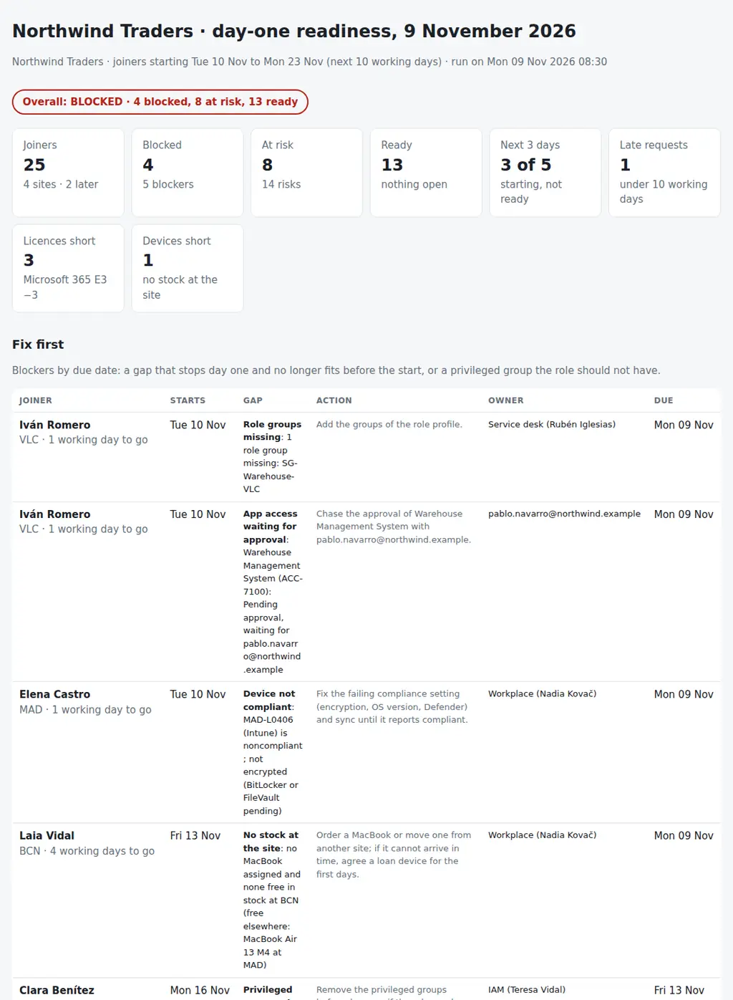

# New Starter Day-One Readiness

The Monday question before the weekly joiners call: for everyone starting in the next ten working days, will they have a working account, licence, groups, access, laptop and phone on day one, and what is missing, who owns it and by when? From the joiner list of HR, the role profiles, the Entra ID accounts, the Intune or Jamf devices, the licences, the stock per site and the access requests, it puts together:

- **Request:** requests raised too late for the lead time, and joiners starting within three working days who are not ready.
- **Account:** missing or disabled, a rehire whose old account should be reused, a duplicate created for a rehire, no employeeId, department or manager different from HR, no usage location (so the licence cannot be assigned), cloud-only in a hybrid directory.
- **Licence:** none, the wrong SKU or an extra one against the role profile, and the licence pool against everyone still to licence.
- **Groups and access:** role groups and distribution lists missing, privileged groups the role should not have (usually copied from a model user), apps and shared mailboxes not requested, waiting for approval, approved and not provisioned, or rejected.
- **Device and phone:** no laptop assigned, no stock of the requested model at the site, the wrong platform, enrolled but not compliant; a role that needs a phone with none requested.
- **MFA on day one:** how the joiner will register a method, with a Temporary Access Pass for the first sign-in.

Every gap has an owner, the working days its fix needs and a due date. Each joiner gets a status (**READY**, **AT RISK** or **BLOCKED**) and a countdown in working days, per site and overall, and the pack for the weekly joiners call has the fix-first list with owner, due date and done columns: **who will not be ready, why, who fixes it and by when.**

Python 3.10+, standard library only. It runs with fictional demo data out of the box. A read-only PowerShell exporter for Microsoft Graph (Entra ID accounts, groups, authentication methods, licences and Intune devices) is included; Jamf Pro inventory exports with the same columns work too.

Joiners are the start of the identity lifecycle that [37-iam-access-review](https://github.com/inigogonzalezgarcia/37-iam-access-review) reviews every month and [03-entra-id-hygiene-audit](https://github.com/inigogonzalezgarcia/03-entra-id-hygiene-audit) audits for MFA gaps and forgotten accounts: an admin group copied from a model user on day one is the finding of the access review three months later.



## Why

Day one is the first impression IT makes, and it is decided in the two weeks before. In a typical fortnight with twenty-five joiners:

- a warehouse operative's request arrives on Friday for Tuesday, and on Monday morning his role group and his access to the warehouse system are still missing;
- the laptop of a trading assistant starting tomorrow is enrolled but not compliant, with BitLocker still pending;
- a marketing specialist asked for a MacBook in an office with none in stock, and an order takes longer than the four days left;
- a finance analyst's account was created by copying a colleague who used to work in IT, and came with an Exchange administrators group;
- another account has no usage location, so the E3 licence was never assigned;
- a rehire's old account is disabled with the same employeeId, and someone created a second one;
- the trader starting next Monday has no approval yet for the market data terminal;
- and the E3 pool has two free licences for five joiners.

HR knows the start dates, Entra ID knows the accounts, Intune knows the laptops, the asset register knows the stock and the ITSM tool knows the access requests. The check joins them by employeeId and UPN, compares each joiner with the profile of their role, and turns every difference into a gap with an owner and a date. The rules are in `settings.json`, `role_profiles.json` and `dayone/checks.py`.

## What it checks

| Area | Code | Gap | Blocks day one |
|---|---|---|---|
| Request | REQ-LATE | Request raised fewer than `lead_time_days` (10) working days before the start | no |
| Account | ACC-MISSING, ACC-DISABLED | No account with the employeeId, planned UPN or name; account disabled (unless `enable_on_start`) | yes |
| Account | ACC-REHIRE, ACC-DUPLICATE | Only a disabled account from an earlier employment (re-enable it); or a new account created next to it | yes |
| Account | ACC-NOID, ACC-DEPT, ACC-MANAGER | Matched by name with no employeeId; department or manager different from HR | no |
| Account | ACC-USAGELOC, ACC-CLOUDONLY | No usage location (no licence can be assigned); cloud-only in a hybrid directory | yes, no |
| Licence | LIC-NONE, LIC-WRONG, LIC-EXTRA | The role's SKU missing, another instead, or another as well | yes, yes, no |
| Licence | LIC-POOL | No free unit left: the joiners in start date order take the free units, the rest need a purchase | yes |
| Groups | GRP-MISSING, GRP-DL | Role groups and distribution lists missing | yes, no |
| Groups | GRP-PRIV | Privileged group not in the role profile | always a blocker |
| Access | APP-NOREQ, APP-PENDING, APP-APPROVED, APP-REJECTED | App not requested, waiting for approval, approved and not provisioned, rejected | yes |
| Access | MBX-NOREQ, MBX-PENDING | Shared mailbox not requested or not provisioned | no |
| Device | DEV-NONE, DEV-NOSTOCK | No laptop assigned, with stock at the site or with none (the order lead time applies) | yes |
| Device | DEV-PLATFORM, DEV-NONCOMPLIANT | Windows for a Mac request or the other way round; enrolled but not compliant, with encryption named | yes |
| Phone | PHN-NONE, PHN-ROLE | Phone requested and not assigned; the role needs one and none was requested | when the role needs it |
| MFA | MFA-NODEVICE, MFA-TAP | No way to register a method under your policy; a Temporary Access Pass to issue on the morning | yes, to do |

Each fix needs a number of working days (`fix_days`: account 1, licence 1, licence purchase 3, groups 1, access approval 2, laptop build 2, order 5…). A gap that blocks day one is a **blocker** when its fix no longer fits in the working days left, or the start is within `urgent_days` (3); otherwise it is a **risk**. A joiner with a blocker is BLOCKED, with a risk AT RISK, and READY with nothing open. The due date of each gap is the start date minus its fix days, never before today.

## Outputs

| File | What |
|---|---|
| `report.html` | Overall status and tiles (blocked, at risk, ready, next three days, late requests, licences and devices short), the fix-first list, the countdown board with a card per joiner and the state of each area, the site table, the licence and device forecasts and every gap |
| `day-one-pack.md` | The pack for the weekly joiners call: agenda, headlines, fix first with owner, due and done columns, joiners by start date with every area, open gaps, sites, licences, devices, scope and evidence, notes and sign-off |
| `joiner-status.csv` | One row per joiner: profile, start date, working days left, status, devices, the state of each area, blockers, risks, first due date and first action |
| `gaps.csv` | Every gap with severity, area, check, item, detail, action, owner, fix days and due date |
| `licence-forecast.csv`, `device-forecast.csv` | Per SKU: joiners, assigned, to assign, free units, short and for whom; per site and device type: requested, assigned, to assign, free in stock, short and the models in stock |
| `actions.csv`, `findings.csv` | Every blocker and risk as an action with a reference, owner, due date and done column; and the gaps grouped by check with the joiners, owner and first due date |

## Try it

```bash
git clone https://github.com/inigogonzalezgarcia/48-new-starter-day-one-readiness.git
cd 48-new-starter-day-one-readiness
python -m dayone demo
```

Open `output/report.html` and `output/day-one-pack.md`.

### The demo data

The demo is a made-up distribution and commodities trading company, Northwind Traders, with four sites: the Madrid head office with the trading desk, Barcelona, the Valencia warehouse and Lisbon. The check runs on Monday 9 November 2026 at 08:30, before the joiners call:

- 27 joiners from HR, 25 of them starting between Tuesday 10 and Monday 23 November; 26 Entra ID accounts (one of them the old account of a rehire), 24 Intune laptops and phones and one Autopilot registration, three licence SKUs, ten stock lines (site, type and model), 33 access requests, and nine role profiles.

Everything is fictional: people, accounts, devices, tickets and numbers. The problems are placed on purpose among the joiners who are ready:

- **Request two days before the start:** a warehouse operative in Valencia starting tomorrow, with his warehouse group missing and his access to the warehouse system waiting for approval.
- **No usage location:** a finance analyst in Barcelona, so Microsoft 365 E3 was never assigned.
- **Rehire:** an account manager whose 2023 account is disabled with the same employeeId while a second account was created for her.
- **E3 pool short by 3:** two free units for five joiners still to licence.
- **MacBook with no stock:** requested in Barcelona, where there is none free, four working days before the start (the two free are in Madrid).
- **Not compliant:** a trading assistant's laptop enrolled in Intune with BitLocker pending, the day before she starts.
- **Market data:** the Bloomberg Terminal access of a trader starting next Monday is still waiting for approval.
- **Model user:** a finance analyst's account with `SG-Role-Exchange-Administrators` copied from a colleague (while the PIM helpdesk group of the service desk analyst is allowed by her profile).
- **Manager:** HR and Entra ID disagree on the manager of the warehouse supervisor.

The result: **BLOCKED** overall; 13 joiners ready, 8 at risk and 4 blocked, with 5 blockers and 14 risks; 3 of the 5 joiners starting in the next three working days not ready; E3 short by 3 and one MacBook short in Barcelona.

## Use it with your own data

1. Export (read-only):
   ```powershell
   .\scripts\Export-DayOneData.ps1 -Joiners .\data\joiners.csv -OutputFolder .\data -IncludeAutopilot
   ```
   - Microsoft Graph PowerShell, signed in interactively with the read scopes `User.Read.All`, `GroupMember.Read.All`, `UserAuthenticationMethod.Read.All`, `DeviceManagementManagedDevices.Read.All` and `Organization.Read.All` (plus `DeviceManagementServiceConfig.Read.All` with `-IncludeAutopilot`): `Get-MgUser -All -Property` with `employeeId`, `usageLocation`, `assignedLicenses` and the rest, `Get-MgUserManager`, `Get-MgUserMemberOf`, `Get-MgUserAuthenticationMethod`, `Get-MgSubscribedSku` and `Get-MgDeviceManagementManagedDevice`. Nothing is written to disk but the CSVs; no credential is stored.
   - A Jamf Pro computer or mobile device inventory export with the serial number, the user's e-mail and the operating system can replace or complement `devices.csv`.
2. Add `joiners.csv` from HR, your `role_profiles.json`, and if you keep them, `stock.csv` and `access_requests.csv`. Adjust `data/settings.json`: horizon, lead time, urgent window, holidays, fix days, privileged group names and owners ([docs/data-format.md](docs/data-format.md) has every column and setting).
3. Build the outputs:
   ```bash
   python -m dayone review data/
   ```

[docs/weekly-joiners-call.md](docs/weekly-joiners-call.md) has who attends, the cadence, how to read the pack, what "ready" means, the model-user pitfalls, rehires and late requests.

The exports contain names, UPNs, group memberships, devices and authentication method counts. Keep them inside your organisation:

- real files at the top level (`joiners*.csv`, `accounts*.csv`, `devices*.csv`, `autopilot*.csv`, `licences*.csv`, `stock*.csv`, `access_requests*.csv`, `role_profiles.json`, `settings.json`, `data/`, `downloads/`) and the `output/` folder are excluded from Git by `.gitignore`;
- only the fictional files in `sample_data/` are committed.

## Tests

```bash
pip install -r requirements-dev.txt
python -m pytest -q
```

GitHub Actions runs them on Python 3.10 and 3.12 on every push, then rebuilds the fictional sample data and the report screenshot from the simulator.

15 tests: loading HR, Graph and Jamf column names (dates with time zones, licence and group lists, free licence units); working days, the countdown, holidays and the horizon; late requests and the urgent window; missing, disabled and name-matched accounts; rehires and duplicates; department, manager, usage location and cloud-only accounts; wrong and extra licences and the pool in start date order; role groups, lists and privileged groups with the allowed ones; every state of an access request; devices with stock, no stock, the wrong platform, compliance and Autopilot; phones and MFA on day one; role profile matching; the pack and the CSVs; missing files; and the demo end to end (deterministic, all eight outputs, every planted finding).

## Next steps

- Run it every Monday before the joiners call, and daily for the joiners inside the urgent window.
- Read the joiners straight from the HR system or the ITSM joiner requests instead of a CSV.
- Read the access requests and their approvals from Jira Service Management through its REST API.
- Keep the gaps of every week to show which roles and which steps keep failing, and feed them back into the role profiles.
- Add facilities (desk, badge, locker) as one more area with its own owner.

## Background

Built from my work onboarding users and running identity and devices:

- running user onboarding (network, e-mail, business applications and legacy system accounts) for retail stores and head office, and assigning Office 365 licences with the service desk;
- Active Directory and Azure AD Connect; Entra ID, Conditional Access, Global Admin and PIM; Exchange Online and shared mailboxes; SharePoint;
- Intune for Windows, macOS, iOS and Android; Jamf Pro for Macs; managed iPhones, iPads and MacBooks; NDES and Cloud PKI; BitLocker;
- PowerShell automation, including Microsoft Graph; Python; Jira Service Management;
- IT site leader in an office that grew from about 15 to over 120 people, supporting around 2,500 users across European offices.

Written from scratch with fictional data; no employer data, systems or exports are used.

## Customisation and contact

Want this adapted to your environment? For example:

- your role profiles, sites, lead times and fix days;
- your HR system or ITSM joiner requests as the source of joiners;
- your asset register for the stock and your access request workflow;
- the pack in the format of your joiners call or onboarding checklist.

Get in touch:

- Website (contact form): [inigogonzalezgarcia.github.io](https://inigogonzalezgarcia.github.io/about.html#contacto)
- LinkedIn: [linkedin.com/in/igonzalez93](https://www.linkedin.com/in/igonzalez93)

## License

MIT
